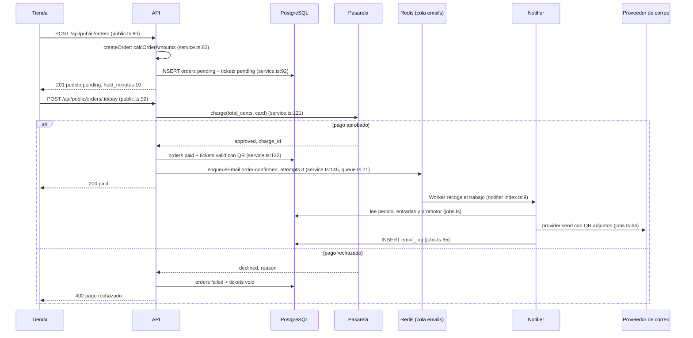

# Laboratorio: entender código heredado con un diagrama

[← Página anterior](07-lab-biblioteca-de-prompts.md) · [Siguiente página →](../M03-del-requisito-a-la-pr/README.md)

La compra de entradas es el flujo más importante de Teatralia y nadie del equipo actual lo escribió: atraviesa la API,
la pasarela de pagos, una cola en Redis y el servicio de correo. En este laboratorio pides a Copilot que lo explique
con un **diagrama de secuencia en Mermaid**, desde que la tienda crea el pedido hasta que sale el correo con las
entradas, y después verificas **cada flecha** contra el código y contra una compra real hecha con `curl`.

### Objetivo

Comprender cómo se usa Copilot para entender un desarrollo existente: cómo se le pide una explicación que se pueda
verificar, cómo se comprueba línea a línea y con datos, dónde suele equivocarse y cómo se corrige el diagrama.

### Punto de partida

- Terminal en la raíz del repositorio y Teatralia en su estado inicial:

```bash
# Descarta cambios en teatralia/ y recarga los datos de ejemplo
CONFIRM=1 make reset
```

- En otra terminal, la plataforma en marcha. Hace falta todo: API, pasarela y notifier (en la salida de `make up`,
  las líneas del notifier llevan el prefijo `[correo]`):

```bash
# Arranca api, pagos, correo, tienda y backoffice; deja esta terminal abierta
make up
```

- Promotor **Sala Faro** (cabecera `x-teatralia-tenant-slug: sala-faro`), evento *Tributo a Mercedes Sosa*
  (`EV-FARO-0047`) con pases VIP `EV-FARO-0047-VIP`. Tarjetas de prueba: `4242 4242 4242 4242` aprueba,
  `4000 0000 0000 0002` rechaza.
- Mailpit (correo de desarrollo) en el puerto **8025**.

### Qué está pasando

| En la realidad | En Teatralia |
|----------------|--------------|
| El comprador elige entradas y pulsa **Comprar** | `POST /api/public/orders` → `createOrder` |
| Las butacas quedan reservadas unos minutos | Pedido `pending`, entradas `pending` |
| El comprador paga | `POST /api/public/orders/:id/pay` → `payOrder` → pasarela |
| Llega el correo con las entradas | Trabajo `order-confirmed` en la cola `emails` → notifier → proveedor de correo |

Un diagrama así es lo primero que pide alguien nuevo en el equipo. Si está mal, enseña mal a todos los que lo lean;
por eso no basta con que «parezca razonable».

### 1 — Pide el diagrama con los ficheros del flujo

Adjuntas los ficheros que intervienen para que Copilot no tenga que adivinar, y le pides que cite la línea de cada
paso: es lo que te permitirá verificarlo.

1. Vista **Chat** (<kbd>Ctrl</kbd>+<kbd>Alt</kbd>+<kbd>I</kbd>), conversación nueva con **+**, modo **Ask**.
2. Envía:

```text
#file:teatralia/services/api/src/routes/public.ts #file:teatralia/services/api/src/orders/service.ts
#file:teatralia/services/api/src/queue.ts #file:teatralia/services/notifier/src/index.ts
#file:teatralia/services/notifier/src/jobs.ts
Dibuja en Mermaid (sequenceDiagram) el flujo de compra de Teatralia: desde que la tienda crea el
pedido hasta que se envía el correo con las entradas. Participantes: Tienda, API, PostgreSQL,
Pasarela, Redis (cola), Notifier y Proveedor de correo. En cada mensaje pon la función y
fichero:línea donde ocurre, y los estados del pedido y de las entradas. Incluye qué pasa si el
pago se rechaza.
```

**Qué debe contener la respuesta** (varía en cada ejecución): un bloque ` ```mermaid ` con `sequenceDiagram`, los siete
participantes y, como mínimo, estos mensajes: `createOrder` calcula importes con `calcOrderAmounts` e inserta el
pedido `pending`; `payOrder` cobra en la pasarela (`charge`), marca el pedido `paid` y las entradas `valid` con su QR, y
encola `order-confirmed`; el notifier recoge el trabajo, envía el correo y lo registra en `email_log`. Si incluye la
rama de pago rechazado, debe decir `failed` / `void` y un 402.

### 2 — Guarda el diagrama en el repositorio

Copias el bloque `mermaid` de la respuesta en un documento para verlo dibujado y revisarlo.

1. Crea `teatralia/docs/flujo-de-compra.md` (en el explorador, clic derecho sobre `teatralia/docs` → **New File…**).
2. Escribe `# Flujo de compra`, una línea en blanco, y pega el bloque ` ```mermaid ` completo. Guarda.
3. Ábrelo con la vista previa de Markdown (<kbd>Ctrl</kbd>+<kbd>Shift</kbd>+<kbd>V</kbd>).

**Resultado esperado:** el diagrama dibujado con las siete columnas. Si la vista previa muestra el código en lugar del
dibujo, VS Code no tiene soporte de Mermaid en la vista previa: instala la extensión **Markdown Preview Mermaid
Support** o míralo en GitHub después de subirlo a tu fork, que lo dibuja sin nada más.

> [!WARNING]
> `make reset` borra lo que no está versionado en `teatralia/`. Si quieres conservar el diagrama, haz commit en tu fork
> antes de cambiar de laboratorio.

### 3 — Verifica cada flecha contra el código

Buscas en el código las líneas que el diagrama dice que existen. Este es el «mapa» que tiene que coincidir:

```bash
# Desde teatralia/: rutas que llaman al servicio, pasos del servicio, la cola y el notifier
cd teatralia
grep -n "createOrder\|payOrder" services/api/src/routes/public.ts
grep -n "calcOrderAmounts(\|INSERT INTO orders\|await charge\|status = 'paid'\|enqueueEmail(" services/api/src/orders/service.ts
grep -n "new Queue\|attempts" services/api/src/queue.ts
grep -n "new Worker\|handle(" services/notifier/src/index.ts
grep -n "provider.send\|logEmail(" services/notifier/src/jobs.ts
```

**Resultado esperado:**

```text
4:import { createOrder, getBuyerOrder, payOrder, releaseExpiredHolds, type CartItem } from '../orders/service.js';
80:      const order = await createOrder({
92:    return payOrder(tenant.id, req.params.id, String(req.body?.card ?? ''));
82:      amounts = calcOrderAmounts(priced, event);
92:      `INSERT INTO orders (id, tenant_id, event_id, buyer_email, subtotal_cents, fee_cents, total_cents, commission_cents)
121:  const result = await charge(order.total_cents, card, orderId);
132:    await db.query(`UPDATE orders SET status = 'paid', paid_at = now(), charge_id = $2 WHERE id = $1`, [
145:  await enqueueEmail({ type: 'order-confirmed', orderId });
14:    queue = new Queue('emails', { connection });
21:    attempts: 3,
9:const worker = new Worker<EmailJob>(
13:    await handle(job.data, job.id);
20:async function logEmail(tenantId: string, provider: string, to: string, subject: string, jobId?: string) {
64:  await provider.send({ from: tenant.email_from, to: order.buyer_email, ...email, attachments });
65:  await logEmail(tenant.id, provider.name, order.buyer_email, email.subject, jobId);
```

**Cómo se lee:** recorre el diagrama mensaje a mensaje y marca en el propio `flujo-de-compra.md` cada línea que no
coincida. Los errores típicos que conviene buscar:

| Lo que a veces dice el diagrama | Lo que dice el código |
|----------------------------------|-----------------------|
| La API envía el correo | La API solo encola (`service.ts:145`); envía el notifier (`jobs.ts:64`) |
| El correo se envía antes de cobrar | `enqueueEmail` va después del `UPDATE … 'paid'` (líneas 132 y 145) |
| Se registra el correo y luego se envía | Primero `provider.send` (64), después `logEmail` (65) |
| Un solo intento | `attempts: 3` en la cola (`queue.ts:21`) |

### 4 — Verifica el flujo con una compra real

El código dice qué **debería** pasar; una compra real dice qué **pasa**. Creas un pedido de un pase VIP, miras su estado,
pagas y vuelves a mirar.

```bash
# 1) La tienda crea el pedido (guarda el id que devuelve)
curl -s -X POST localhost:3000/api/public/orders -H 'x-teatralia-tenant-slug: sala-faro' -H 'content-type: application/json' \
  -d '{"event_id":"EV-FARO-0047","buyer_email":"lucia.prueba@ejemplo.test","items":[{"pass_type_id":"EV-FARO-0047-VIP","quantity":1}]}'; echo
```

**Resultado esperado** (el número de pedido depende de cuántos se hayan creado desde el último `make reset`):

```text
{"id":"PED-2026-2468","status":"pending","subtotal_cents":5500,"fee_cents":90,"total_cents":5590,"commission_cents":413,"lines":[{"price_cents":5500,"fee_cents":90,"commission_cents":413}],"hold_minutes":10}
```

```bash
# 2) Estado antes de pagar (cambia PED-2026-2468 por tu número)
PED=PED-2026-2468
psql "$DATABASE_URL" -c "SELECT id, status, total_cents FROM orders WHERE id = '$PED'" -c "SELECT id, status, qr_token IS NOT NULL AS tiene_qr FROM tickets WHERE order_id = '$PED'"
```

```text
      id       | status  | total_cents 
---------------+---------+-------------
 PED-2026-2468 | pending |        5590
(1 row)

       id        | status  | tiene_qr 
-----------------+---------+----------
 PED-2026-2468-1 | pending | f
(1 row)
```

```bash
# 3) El comprador paga; unos segundos después, estado del pedido, de la entrada y registro del correo
curl -s -X POST localhost:3000/api/public/orders/$PED/pay -H 'x-teatralia-tenant-slug: sala-faro' -H 'content-type: application/json' \
  -d '{"card":"4242 4242 4242 4242"}'; echo
sleep 3
psql "$DATABASE_URL" -c "SELECT id, status, charge_id IS NOT NULL AS cobrado FROM orders WHERE id = '$PED'" \
  -c "SELECT id, status, qr_token IS NOT NULL AS tiene_qr FROM tickets WHERE order_id = '$PED'" \
  -c "SELECT provider, to_address, subject FROM email_log WHERE to_address = 'lucia.prueba@ejemplo.test'"
```

**Resultado esperado** (el `charge_id` cambia en cada pago):

```text
{"id":"PED-2026-2468","status":"paid","charge_id":"ch_8289ba422c18ed86"}
      id       | status | cobrado 
---------------+--------+---------
 PED-2026-2468 | paid   | t
(1 row)

       id        | status | tiene_qr 
-----------------+--------+----------
 PED-2026-2468-1 | valid  | t
(1 row)

 provider |        to_address         |                          subject                          
----------+---------------------------+-----------------------------------------------------------
 smtp     | lucia.prueba@ejemplo.test | Tus entradas para Tributo a Mercedes Sosa — PED-2026-2468
(1 row)
```

En la terminal de `make up`, el notifier deja estas dos líneas (el número de trabajo cambia):

```text
→ order-confirmed #1 (intento 1)
✓ order-confirmed #1
```

**Cómo se lee:**

| Momento | Pedido | Entrada | Correo | Flecha del diagrama que confirma |
|---------|--------|---------|--------|----------------------------------|
| Tras crear | `pending` | `pending`, sin QR | — | `createOrder` → `INSERT` |
| Tras pagar | `paid`, con `charge_id` | `valid`, con QR | Registrado por `smtp` | `charge` → `UPDATE … paid` → `enqueueEmail` |
| Notifier | — | — | Un intento, completado | `Worker` → `handle` → `provider.send` → `logEmail` |

El correo también está en Mailpit (puerto 8025), con el QR adjunto. Si alguna fila no coincide con tu diagrama, corrígelo.

<details>
<summary>Diagrama de referencia (<code>teatralia/docs/flujo-de-compra.md</code>)</summary>



</details>

## Comprueba tu entendimiento

**Quién envía el correo**
`grep -n "provider.send\|sendMail" teatralia/services/api/src/**/*.ts teatralia/services/api/src/*.ts`
→ Sin resultados: la API no envía correos, solo encola. Si tu diagrama tenía una flecha de la API al proveedor, está mal.

**El orden cobrar → encolar**
Abre `teatralia/services/api/src/orders/service.ts` en las líneas 121 a 145.
→ El cargo (121), el `UPDATE` a `paid` (132) y `enqueueEmail` (145), en ese orden: sin pago aprobado no hay correo.

## Investiga

¿Qué pasa con las butacas de un pedido que nunca se paga? El diagrama dice «pedido `pending`», pero no cuánto dura.
Busca dónde caduca y compruébalo en el código:

```bash
# Dónde se anulan los pedidos pendientes y cuántos minutos dura la reserva
grep -n "releaseExpiredHolds\|holdMinutes" teatralia/services/api/src/orders/service.ts teatralia/services/api/src/config.ts
```

Pregunta a Copilot, con esos dos ficheros, quién llama a `releaseExpiredHolds` y cuándo; luego decide si esa rama merece
estar en el diagrama (una pista: no hay ningún proceso periódico, se ejecuta al crear un pedido o al consultar butacas).

## Reto

### 1 — Verificar la rama del pago rechazado

**La situación:** el diagrama incluye una rama `else` para el pago rechazado, pero nadie la ha visto funcionar. Un
compañero cree que, si la tarjeta se rechaza, el pedido se queda `pending` hasta que caduca y que el comprador recibe
igualmente un correo.

**Qué haces:** crea otro pedido del mismo pase y págalo con la tarjeta `4000 0000 0000 0002`. Después mira el estado del
pedido, de su entrada y cuántos correos hay registrados para esa dirección.

```bash
# Pedido nuevo (guarda el id) y pago con la tarjeta que rechaza
curl -s -X POST localhost:3000/api/public/orders -H 'x-teatralia-tenant-slug: sala-faro' -H 'content-type: application/json' \
  -d '{"event_id":"EV-FARO-0047","buyer_email":"lucia.prueba@ejemplo.test","items":[{"pass_type_id":"EV-FARO-0047-VIP","quantity":1}]}'; echo
```

**Pistas:** la respuesta del pago incluye un código HTTP; `curl -i` lo enseña. El pedido y sus entradas se consultan
como en el paso 4; los correos, en `email_log`.

**Lo que buscas:** el código HTTP del pago, el estado del pedido y de la entrada, y si el número de correos de
`lucia.prueba@ejemplo.test` ha cambiado. Con eso, confirma o corrige la rama `else` de tu diagrama.

<details>
<summary>Ver solución</summary>

```bash
PED=PED-2026-2469   # el id que te haya devuelto la creación
curl -s -i -X POST localhost:3000/api/public/orders/$PED/pay -H 'x-teatralia-tenant-slug: sala-faro' -H 'content-type: application/json' \
  -d '{"card":"4000 0000 0000 0002"}' | sed -n '1p;$p'; echo
psql "$DATABASE_URL" -c "SELECT o.id, o.status AS pedido, t.status AS entrada, o.charge_id FROM orders o JOIN tickets t ON t.order_id = o.id WHERE o.id = '$PED'" \
  -c "SELECT count(*) AS correos FROM email_log WHERE to_address = 'lucia.prueba@ejemplo.test'"
```

Salida real (después de la compra del paso 4):

```text
HTTP/1.1 402 Payment Required
{"error":"pago rechazado: fondos insuficientes"}
      id       | pedido | entrada | charge_id 
---------------+--------+---------+-----------
 PED-2026-2469 | failed | void    | 
(1 row)

 correos 
---------
       1
(1 row)
```

El compañero se equivoca en las dos cosas: el pedido pasa a `failed` en el momento (no se queda `pending`), la entrada a
`void` (la butaca o el pase se liberan ya) y no hay correo nuevo: el único registrado es el de la compra pagada del
paso 4. Corresponde a `service.ts:123-129`, el bloque `if (result.status !== 'approved')`, que lanza el 402 **antes**
de llegar a `enqueueEmail`. **La regla:** una rama del diagrama que no has visto ejecutarse es una hipótesis; se
convierte en documentación cuando la provocas y los datos coinciden.

</details>

## Errores frecuentes

| Síntoma | Causa probable | Cómo arreglarlo |
|---------|----------------|-----------------|
| La vista previa muestra el código Mermaid, no el dibujo | La vista previa de VS Code no trae Mermaid | Extensión **Markdown Preview Mermaid Support**, o míralo en GitHub |
| Error de sintaxis al dibujar | Paréntesis o dos puntos de más en un mensaje, o falta `end` | Revisa la línea que indica el error; cada `alt` cierra con `end` |
| El pago responde 409 «el pedido está failed» | El pedido caducó (más de 10 minutos en `pending`) o ya se intentó pagar | Crea un pedido nuevo |
| `email_log` sin filas tras pagar | El notifier no está en marcha | Mira la terminal de `make up`: tiene que haber líneas `[correo]` |
| `psql` no encuentra el pedido | `$PED` tiene otro número | Usa el `id` exacto que devolvió la creación |

## Conclusiones

### Qué es entender un desarrollo existente con Copilot

Pedir una explicación **verificable** (un diagrama donde cada mensaje cita su función y su línea) y comprobarla dos veces:
contra el código, con `grep`, y contra el sistema, provocando el flujo y mirando los datos.

```text
ficheros adjuntos → diagrama con fichero:línea → grep de cada flecha → compra real → diagrama corregido y versionado
```

### Cómo debe ser

| Requisito | En el lab |
|-----------|-----------|
| Ficheros del flujo adjuntos | Cinco `#file`, de la ruta al notifier |
| Cada mensaje con su `fichero:línea` | Contrastado con los `grep` del paso 3 |
| Estados del dato en cada paso | `pending` → `paid`/`valid` → `email_log` |
| Ramas de error incluidas y provocadas | Tarjeta `4000 0000 0000 0002`: 402, `failed`, `void` |
| Guardado junto al código | `teatralia/docs/flujo-de-compra.md` |

### Dónde se rompe y cómo lo has detectado

| Fallo | Cómo lo has visto | Qué provoca |
|-------|-------------------|-------------|
| Flechas inventadas (la API envía el correo) | `grep` sin `provider.send` en la API | Quien lo lea busca el fallo donde no está |
| Orden equivocado | Líneas 121, 132 y 145 de `service.ts` | Creer que se envían correos sin cobrar |
| Ramas sin comprobar | Reto: el rechazo no deja el pedido `pending` | Hipótesis convertidas en documentación |

### Cómo se perfecciona

El diagrama verificado se versiona junto al código y se revisa cuando cambian los ficheros que cita: si una línea ya no
existe, el diagrama ha caducado. Las ramas importantes (pago rechazado, reintentos de la cola) se cubren con tests o
con una prueba de extremo a extremo que haga lo mismo que los `curl` de este laboratorio.

### En una frase

> 🔑 Una explicación de código heredado vale lo que sus comprobaciones: pide a Copilot que cite cada línea, verifícala
> con `grep` y provoca el flujo para ver los datos.
