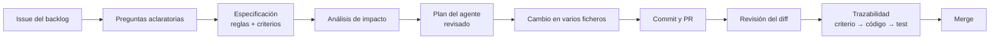

# M03 — Del requisito de negocio a la pull request

[← Página anterior](../M02-contexto-y-personalizacion/08-lab-diagrama-del-flujo-de-compra.md) · [Siguiente página →](00-de-la-peticion-al-merge.md)

Un issue de Teatralia rara vez llega listo para programar: «queremos una lista de espera», «un abono de temporada»,
«códigos de descuento». Entre esa frase y una pull request que el equipo puede aprobar hay un recorrido: aclarar lo
que no se dijo, escribirlo como especificación verificable, ver qué piezas toca, planificar, implementar en varios
ficheros, contar el cambio en el commit y en la PR, revisarlo y poder demostrar qué criterio cubre cada línea y cada
test. Este módulo recorre ese camino **del requisito de negocio a la pull request** con Copilot en cada paso, y en
cada paso contrasta lo que dice Copilot con el código, la base de datos o el `git diff`.

## Qué aprenderás

- Leer una petición del backlog de Teatralia (lista de espera del Auditorio El Olivo) y sacar las preguntas que el promotor tiene que contestar antes de programar.
- Convertir el issue de códigos de descuento en reglas y criterios Dado / Cuando / Entonces con importes reales en céntimos.
- Medir el impacto del abono de temporada del Teatro Lumen sobre tablas, rutas, pantallas y datos existentes, verificado con `grep` y `psql`.
- Pedir al agente un plan, corregirlo con lo que sabes del sistema y solo entonces dejarle ejecutar.
- Llevar un cambio de migración, API y backoffice revisando fichero a fichero lo que propone el agente.
- Generar mensajes de commit y descripciones de PR con Copilot y corregirlos contra el diff real.
- Revisar con Copilot un diff con fallos sembrados y distinguir lo que encuentra de lo que se le escapa.
- Construir una matriz criterio → código → test y encontrar los huecos antes de que los encuentre producción.

## Teoría

### El ciclo de un cambio asistido

Copilot acelera cada caja, pero **ninguna flecha la decide él**: las preguntas las contesta el promotor, el plan lo
aprueba quien conoce el sistema, el mensaje del commit lo firma quien lo sube y el merge lo hace quien ha revisado.

| Paso | Qué aporta Copilot | Qué compruebas tú | Contra qué |
|------|--------------------|-------------------|------------|
| Preguntas aclaratorias | Lista de huecos y supuestos de la petición | Si la respuesta ya está en el código o solo la sabe el negocio | `grep`, `psql` |
| Especificación | Reglas y criterios redactados | Que cada número cuadra con los datos y la convención de céntimos | Un pedido real (`PED-2026-0107`) |
| Análisis de impacto | Ficheros y tablas candidatos | Que existen y que no falta ninguno | `grep -rn`, esquema |
| Plan | Pasos, ficheros, orden | Alcance, reglas del sistema (promotor, céntimos), lo que sobra | Tu conocimiento + el issue |
| Implementación | Cambios en varios ficheros | Cada fichero, uno por uno, antes de **Keep** | `git diff`, tests, `curl` |
| Commit y PR | Mensaje y descripción | Que lo que dicen está en el diff y nada más | `git diff --stat` |
| Revisión | Hallazgos sobre el diff | Lo que encuentra y lo que no | Datos reales y `curl` |
| Trazabilidad | Matriz propuesta | Que cada test nombrado existe y prueba lo que dice | `vitest --reporter verbose` |

> [!NOTE]
> **Requisito, especificación y criterio de aceptación no son lo mismo.** El requisito es lo que pide el negocio
> («códigos de descuento»). La especificación lo convierte en reglas sin ambigüedad («el descuento sale del subtotal,
> nunca de los gastos»). El criterio de aceptación es un ejemplo comprobable de una regla («con NAVIDAD10 el total
> de PED-2026-0107 baja de 13370 a 12060 céntimos»). Un criterio que no se puede ejecutar contra el sistema todavía
> es una opinión.

### Lo que Copilot no ve

Copilot ve el repositorio y lo que le adjuntas. No ve el correo del promotor, la reunión con Finanzas ni lo que se
decidió en la última retro. Tampoco ve GitHub (issues, PR, comentarios) salvo que se lo pegues o que el agente ejecute
`gh` en la terminal. Por eso la petición, las decisiones y los criterios tienen que **acabar escritos en el
repositorio o en el issue**: es la única forma de que el siguiente prompt, y el siguiente compañero, los tengan.

> [!WARNING]
> Copilot code review en una pull request de github.com (pedir a Copilot como revisor) necesita un plan de pago.
> En este módulo la revisión se hace en el chat de VS Code sobre el `git diff`, que funciona con Copilot Free; la
> revisión en github.com se menciona como alternativa.

## Páginas

<!-- gen:paginas -->
| # | Página | Qué hay |
|---|--------|---------|
| 00 | [Demo: de la petición al merge](00-de-la-peticion-al-merge.md) | Un issue pequeño del backlog recorrido entero con Copilot, de la lectura al merge |
| 01 | [Laboratorio: preguntas aclaratorias](01-lab-preguntas-aclaratorias.md) | La petición de lista de espera tal como llega, sus huecos y las preguntas para el promotor |
| 02 | [Laboratorio: especificación desde un issue](02-lab-especificacion-desde-un-issue.md) | El issue de códigos de descuento convertido en especificación con reglas y criterios de aceptación |
| 03 | [Laboratorio: análisis de impacto](03-lab-analisis-de-impacto.md) | Qué piezas de Teatralia toca el abono de temporada y qué datos existentes se ven afectados |
| 04 | [Laboratorio: plan antes de ejecutar](04-lab-plan-antes-de-ejecutar.md) | Pedir al agente un plan, corregirlo y solo entonces dejarle ejecutar |
| 05 | [Laboratorio: un cambio en varios ficheros](05-lab-cambio-en-varios-ficheros.md) | Códigos de descuento en API y backoffice con el agente, revisando cada fichero tocado |
| 06 | [Laboratorio: commit y pull request](06-lab-commit-y-pull-request.md) | Mensaje de commit y descripción de pull request generados y corregidos contra el diff real |
| 07 | [Laboratorio: revisar un diff con Copilot](07-lab-revisar-un-diff.md) | Una rama con tres fallos sembrados revisada con Copilot; qué encuentra y qué se le escapa |
| 08 | [Laboratorio: trazabilidad requisito, código y prueba](08-lab-trazabilidad.md) | Una matriz que une cada criterio de aceptación con su código y su test, y los huecos que aparecen |

→ Empieza por **[00 — Demo: de la petición al merge](00-de-la-peticion-al-merge.md)**.
<!-- /gen:paginas -->

## Conclusiones del módulo

### Qué se ha visto

Un cambio asistido es una cadena: petición → preguntas → especificación → impacto → plan → código → commit y PR →
revisión → trazabilidad. Copilot redacta, busca y propone en cada eslabón; cada eslabón se cierra con una
comprobación contra Teatralia (`psql`, `grep`, `curl`, tests, `git diff`).

### Lo que los datos de Teatralia han enseñado

| Hallazgo | Dónde | Qué habría pasado sin comprobarlo |
|----------|-------|-----------------------------------|
| Los tres eventos «agotados» tienen entradas libres (41 en el Concierto de Navidad) | Lista de espera | Una lista de espera para un evento que todavía vende |
| «Abono» ya existe como pase de un evento (Festival Alborada) y un pedido pertenece a un solo evento | Abono de temporada | Un modelo que reutiliza `pass_types` y no puede cruzar funciones |
| Un pedido con descuento no se puede reembolsar por cancelación (error interno) | Códigos de descuento | Un fallo en la primera cancelación con códigos activos |
| Un diff con tests en verde exportaba las ventas de todos los promotores | Exportar ventas | Fuga de datos entre promotores aprobada por «los tests pasan» |

### En una frase

> 🔑 Copilot escribe cada paso del camino del issue a la PR; el camino solo es fiable si cada paso termina en una comprobación contra el sistema y no en la respuesta del chat.
